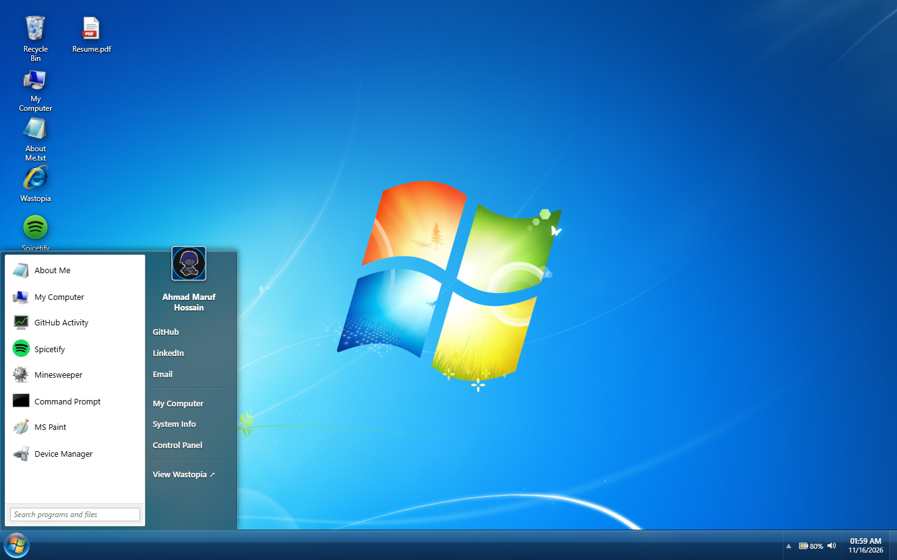

# SpicyFalcon OS

**A portfolio you boot into.** SpicyFalcon OS recreates a Windows 7 desktop in the browser: draggable windows, a taskbar, a Start menu and a dozen working apps. My projects, skills and CV live inside it as files and programs.

**[spicyfalcon-os.vercel.app](https://spicyfalcon-os.vercel.app)** · [Résumé (PDF)](https://spicyfalcon-os.vercel.app/resume.pdf) · [Classic portfolio](https://spicyfalcon-portfolio.vercel.app)



## What you can do

| On the desktop | What it is |
|---|---|
| **About Me.txt** | The portfolio app: about, skills, education and all projects, each opening its live site |
| **Resume.pdf** | My CV in a document viewer, with Download and Open in new tab |
| **My Computer** | A file explorer with quick links to GitHub, LinkedIn and email |
| **Spicetify** | A Spotify-styled music player |
| **Start menu** | MS Paint, Minesweeper, Command Prompt, Calculator, Task Manager, Device Manager, System Properties, Internet Explorer and more |

Windows drag, focus, minimise and maximise; icons can be rearranged; right-clicking the desktop opens a context menu. There is a boot screen, a screensaver and, if you look for it, a blue screen.

## How it works

- **Window manager:** a Zustand store ([`useWindowStore`](src/store/useWindowStore.js)) keeps every open window's position, size and stacking order; the focused window always comes to the front. Dragging uses pointer capture, so a window never drops when the mouse moves fast.
- **Apps load on demand:** [`AppRouter`](src/components/apps/AppRouter.jsx) lazy-loads each program the first time it is opened, which keeps the first load small.
- **One source of content:** bio, skills, education and projects live in [`src/data/portfolioData.js`](src/data/portfolioData.js) and feed the portfolio app, Notepad, the Start menu and System Properties.
- **No secrets in the browser:** the music player asks a small Vercel function ([`api/playlist.js`](api/playlist.js)) for the playlist, so the Spotify credentials stay on the server. Without them it plays a saved playlist.
- **Look and feel:** CSS custom properties recreate Aero glass, with [7.css](https://khang-nd.github.io/7.css/) for period-correct controls and Tabler icons.

## Tech stack

React 19, Vite, Zustand, Framer Motion, 7.css, Tabler Icons, mathjs (calculator), and a Vercel serverless function. Hosted on Vercel.

## Run it locally

```bash
npm install
npm run dev        # http://localhost:5173
npm run build      # static output in dist/
```

The music player uses its saved playlist locally. To load the live Spotify playlist, set `SPOTIFY_CLIENT_ID`, `SPOTIFY_CLIENT_SECRET` and `SPOTIFY_PLAYLIST_ID` in Vercel (see [SETUP_SPICETIFY.md](SETUP_SPICETIFY.md)) and run `vercel dev`.

## Project structure

```text
src/
  components/
    apps/        each program (Paint, Minesweeper, Portfolio, DocumentViewer, ...)
    desktop/     desktop, icons, taskbar, Start menu, context menu
    window/      the window frame and its draggable title bar
    shared/      boot screen, screensaver, blue screen
  store/         window, desktop and settings state (Zustand)
  data/          portfolio content and the saved playlist
api/             serverless function for the Spotify playlist
public/          icons, wallpapers, audio, resume.pdf
```

[TUTORIAL.md](TUTORIAL.md) walks through how the whole system was built, phase by phase.

## Credits

The Windows 7 look is a tribute; Windows and its icons are trademarks of Microsoft. Music in the player belongs to its artists.
